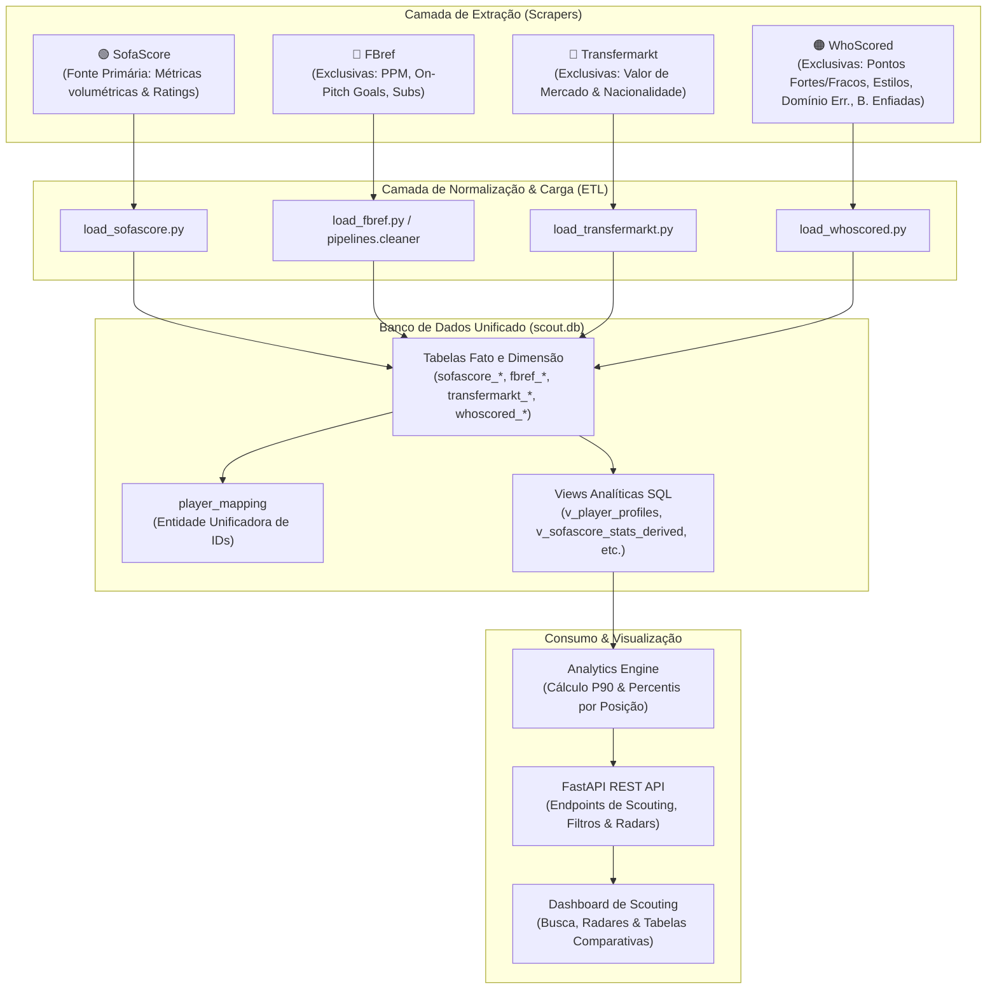

# ⚽ Scout Data Scraper & Analytics Platform

Plataforma profissional de engenharia de dados e scouting esportivo para extração, unificação, modelagem analítica e visualização de jogadores brasileiros nas **11 principais ligas do futebol mundial**.

---

## 🏛️ Visão Geral da Arquitetura

O sistema opera com um pipeline de dados convergente em 4 fontes complementares de dados, sem duplicação ou redundância de métricas, elegendo o **SofaScore** como autoridade primária de métricas volumétricas:



---

## 🎯 Escopo de Ligas Alvo (11 Ligas)

A coleta abrange exclusivamente atletas de **nacionalidade brasileira** pertencentes ao elenco principal de clubes participantes das seguintes ligas:

| Código | Liga | País | URL Transfermarkt |
| :--- | :--- | :--- | :--- |
| **ING** | Premier League | Inglaterra | [GB1](https://www.transfermarkt.com.br/premier-league/startseite/wettbewerb/GB1) |
| **ESP** | LaLiga | Espanha | [ES1](https://www.transfermarkt.com.br/laliga/startseite/wettbewerb/ES1) |
| **ITA** | Serie A | Itália | [IT1](https://www.transfermarkt.com.br/serie-a/startseite/wettbewerb/IT1) |
| **ALE** | Bundesliga | Alemanha | [L1](https://www.transfermarkt.com.br/bundesliga/startseite/wettbewerb/L1) |
| **FRA** | Ligue 1 | França | [FR1](https://www.transfermarkt.com.br/ligue-1/startseite/wettbewerb/FR1) |
| **BRA** | Brasileirão Série A | Brasil | [BRA1](https://www.transfermarkt.com.br/campeonato-brasileiro-serie-a/startseite/wettbewerb/BRA1) |
| **ARA** | Saudi Pro League | Arábia Saudita | [SA1](https://www.transfermarkt.com.br/saudi-professional-league/startseite/wettbewerb/SA1) |
| **HOL** | Eredivisie | Países Baixos | [NL1](https://www.transfermarkt.com.br/eredivisie/startseite/wettbewerb/NL1) |
| **POR** | Liga Portugal | Portugal | [PO1](https://www.transfermarkt.com.br/liga-portugal/startseite/wettbewerb/PO1) |
| **EUA** | Major League Soccer | Estados Unidos | [MLS1](https://www.transfermarkt.com.br/major-league-soccer/startseite/wettbewerb/MLS1) |
| **MEX** | Liga MX (Ape./Clau.) | México | [MEXA](https://www.transfermarkt.com.br/liga-mx-apertura/startseite/wettbewerb/MEXA) |

### Regras de Negócio e Governança de Dados
1. **Filtro Estrito de Nacionalidade**: Apenas atletas cuja nacionalidade primária (seleção elegível) seja o Brasil. Casos de dupla nacionalidade onde o atleta optou por outra seleção (ex: Matheus Nunes / Portugal no Manchester City) são descartados automaticamente na camada de ingestão.
2. **SofaScore como Fonte Primária**: Todas as estatísticas cumulativas e volumétricas por jogo (passes certos, finalizações, interceptações, desarmes, xG, xA, rating) originam-se do SofaScore.
3. **Métricas Sem Sobreposição (Exclusividade)**:
   - **FBref**: Apenas dados não cobertos pelo Sofascore: PPM (*Points Per Match* quando o atleta esteve em campo), gols a favor/contra *on-pitch* (`onG`, `onGA`), substituições (`subs_in`, `subs_unused`) e métricas específicas de pênaltis para goleiros.
   - **Transfermarkt**: Valor de mercado monetário atual (`market_value_raw`), link do perfil e dados contratuais.
   - **WhoScored**: Características táticas qualitativas do time e do atleta (`strengths`, `weaknesses`, `style_of_play`), contagem de homem do jogo (`motm`), bolas enfiadas por jogo (`through_balls_per_game`), perdas de controle de bola (`dispossessed_per_game`) e toques mal-sucedidos (`unsuccessful_touches_per_game`).

---

## 📁 Estrutura do Projeto

```text
Scout-Data-Scraper/
│
├── api/                          # Camada de API RESTful
│   └── main.py                   # FastAPI: endpoints de busca, filtros e percentis
│
├── core/                         # Núcleo da arquitetura
│   ├── browser.py                # Wrapper com stealth anti-bot e headers
│   ├── database.py               # Configuração SQLAlchemy, engine e FKs SQLite
│   ├── models.py                 # Schemas ORM das 4 fontes e da player_mapping
│   ├── settings.py               # Variáveis de ambiente e caminhos centrais
│   ├── sofascore_metrics.py      # Dicionário de normalização de métricas SofaScore
│   └── views.py                  # DDL de Views SQL consolidadas (Gold Layer)
│
├── pipelines/                    # Pipelines ETL especializados
│   └── cleaner.py                # Processamento, desduplicação e carga do FBref
│
├── scrapers/                     # Motores de web scraping por fonte
│   ├── fbref/                    # Spiders FBref (ligas e páginas de jogadores)
│   ├── sofascore/                # Spiders SofaScore (clubes, elencos e estatísticas)
│   ├── transfermarkt/            # Spiders Transfermarkt (elencos e valores de mercado)
│   └── whoscored/                # Spiders WhoScored (clubes, características e detalhes)
│
├── scripts/                      # Utilitários de diagnóstico e validação
│   ├── inspect_fbref.py          # Dossiê de validação individual FBref
│   ├── inspect_sofascore.py      # Dossiê de validação individual SofaScore
│   └── test_gold.py              # Teste de junção e integridade multi-fontes
│
├── analytics_engine.py           # Motor estatístico P90 e percentis por posição
├── load_fbref.py                 # Loader do FBref para o scout.db
├── load_sofascore.py             # Loader do SofaScore para o scout.db
├── load_transfermarkt.py         # Loader do Transfermarkt para o scout.db
├── load_whoscored.py             # Loader do WhoScored para o scout.db
├── match_ids.py                  # Algoritmo de resolução de identidades (Entity Matching)
├── main.py                       # Orquestrador geral do pipeline
├── requirements.txt              # Dependências Python do ecossistema
├── .env.example                  # Template de configuração de variáveis
└── .gitignore                    # Regras de exclusão de dados e binários
```

---

## 🗄️ Esquema de Dados e Resolução de Entidades

A unificação dos registros em diferentes plataformas é centralizada na tabela `player_mapping`:

```sql
CREATE TABLE player_mapping (
    id INTEGER PRIMARY KEY AUTOINCREMENT,
    merged_name VARCHAR(150) NOT NULL,
    birth_date DATE,
    position VARCHAR(50),
    sofascore_id INTEGER REFERENCES sofascore_players(id),
    fbref_db_id INTEGER REFERENCES fbref_players(id),
    transfermarkt_id INTEGER REFERENCES transfermarkt_players(id),
    whoscored_id INTEGER REFERENCES whoscored_players(id),
    confidence_score FLOAT,
    match_method VARCHAR(50),
    created_at DATETIME
);
```

### 🧠 Padronização Posicional de Scouting (`core/scouting_roles.py`)
Para comparações estatísticas justas, as nomenclaturas de posições das 4 fontes são padronizadas em **7 Funções Táticas Principais** e **4 Macro-Categorias**:

| Função Tática (`scout_role`) | Macro-Categoria (`scout_category`) | Descrição e Exemplos Mapeados |
| :--- | :--- | :--- |
| **GK** | `GK` | Goleiro (*Goalkeeper, Guarda-redes*) |
| **CB** | `DEF` | Zagueiro Central (*Centre-Back, Líbero, D(C)*) |
| **FB** | `DEF` | Lateral / Ala Direito ou Esquerdo (*Full-Back, Wing-Back, LB, RB, D(D), D(E)*) |
| **DM** | `MID` | Volante / Meio-Campo Defensivo (*Defensive Midfielder, DM*) |
| **CM_AM** | `MID` | Meia Central / Ofensivo / Armador (*Central/Attacking Midfield, CM, AM, M(C)*) |
| **WNG** | `ATT` | Ponta / Extremo / Atacante de Lado (*Winger, M(D), M(E), A(D), A(E)*) |
| **ST** | `ATT` | Centroavante / Homem de Área (*Striker, Centre-Forward, PL, A(C)*) |

### 🏆 Camada Gold e Motor Analítico (`v_player_gold_analytics`)
A View analítica consolida:
1. **Perfil Unificado** (`v_player_profiles`): Dossiê cadastral, valor de mercado em euros (Transfermarkt), URLs de perfis e características qualitativas (WhoScored).
2. **Métricas Primárias (SofaScore)**: Minutos jogados, Gols, Assistências, xG, xA, Finalizações, Passes Chave, Dribles Certos %, Duelos Ganhos %, Desarmes, Interceptações e Rating.
3. **Métricas Exclusivas (FBref)**: Pontos por Partida (PPM), Saldo de Gols On-Pitch, Jogos Completos e Substituições.
4. **Métricas Exclusivas (WhoScored)**: Homem do Jogo (MOTM), Nota WhoScored, Bolas Enfiadas por Jogo, Perda de Posse por Jogo e Domínios Errados por Jogo.
5. **Cálculo P90 e Percentis por Posição**: Percentis calculados comparando apenas atletas que compartilham o mesmo `scout_role` com filtro de minutos mínimos (ex: $\ge 450$ min).
6. **Similaridade de Atletas**: Motor vetorial de distância Euclidiana/Cosseno no espaço de percentis para encontrar os jogadores mais similares na base.

### Algoritmo Determinístico de Matching (`match_ids.py`)
1. **Passo 1 (Exato)**: Normalização semântica (remoção de acentos e casing) + Data de nascimento exata (`birth_date`).
2. **Passo 2 (Ano & Posição)**: Nome normalizado idêntico + Ano de nascimento idêntico + compatibilidade posicional.
3. **Passo 3 (Fuzzy Levenshtein)**: Similaridade de nome $\ge 0.88$ + Clube atual coincidente + Data de nascimento idêntica.

---

## 💡 Estratégia de Infraestrutura 100% Gratuita (Zero Gastos)

O projeto foi projetado para operar com **custo zero** de ponta a ponta:

1. **Scraping Anti-Bot Local**: Utiliza `seleniumbase` com modo Undetected Chromedriver (`uc=True`) diretamente no IP residencial do operador, contornando Cloudflare Turnstile e captchas sem a necessidade de proxys pagos.
2. **Armazenamento de Alta Performance**: Banco de dados SQLite embarcado com modo WAL (*Write-Ahead Logging*), oferecendo centenas de milhares de leituras por segundo sem custos de hosting de banco de dados.
3. **API e Servidor**: FastAPI de baixíssima latência executável localmente ou em *free tiers* (Render, Fly.io ou Vercel Serverless).
4. **Deploy de Frontend**: Compatível com Streamlit Community Cloud (gratuito via GitHub) ou SPA React hospedada na Vercel.

---

## 🚀 Instalação e Configuração

### Pré-requisitos
- Python 3.10 ou superior
- Google Chrome instalado no sistema

### 1. Clonar o Repositório
```bash
git clone https://github.com/SEU_USUARIO/Scout-Data-Scraper.git
cd Scout-Data-Scraper
```

### 2. Criar e Ativar o Ambiente Virtual
No Windows (PowerShell):
```powershell
python -m venv venv
.\venv\Scripts\Activate.ps1
```

### 3. Instalar Dependências
```bash
pip install -r requirements.txt
```

### 4. Configurar Variáveis de Ambiente
Copie o modelo de configuração:
```bash
copy .env.example .env
```

---

## ⚙️ Execução e Orquestração do Pipeline

O projeto dispõe do orquestrador central [main.py](file:///c:/Users/Marcos/Scout-Data-Scraper/main.py) com CLI interativa para controle completo do ciclo de vida dos dados:

### 1. Diagnóstico e Telemetria dos Dados
Exibe o volume de dados coletados e contagem de registros em cada tabela do SQLite:
```powershell
python main.py status
```

### 2. Higienização e Reset Geral (Do Zero)
Para realizar uma nova coleta limpa descartando dados legados e recriando o schema do banco:
```powershell
python main.py reset --force
```

### 3. Coleta de Dados (Web Scraping)
Coleta isolada de uma fonte específica ou de todas as 4 fontes sequencialmente:
```powershell
# Coleta individual
python main.py scrape sofascore
python main.py scrape fbref
python main.py scrape transfermarkt
python main.py scrape whoscored

# Coleta global (todas as 4 fontes)
python main.py scrape all
```

### 4. Carga no Banco de Dados (ETL)
Processa os dumps brutos e persiste nas tabelas fato/dimensão:
```powershell
python main.py load all
# ou individualmente: python main.py load sofascore / fbref / transfermarkt / whoscored
```

### 5. Resolução e Cruzamento de Identidades
Executa o algoritmo determinístico de matching para unificar os 4 IDs em `player_mapping`:
```powershell
python main.py match
```

### 6. Execução End-to-End Automática
Executa o fluxo completo (Reset opcional ➔ Scrape 4 fontes ➔ Carga ETL ➔ Matching ➔ Status final):
```powershell
python main.py run-all --reset --force
```

### 7. Inicialização da API RESTful
Inicia o servidor FastAPI local:
```powershell
python main.py api --port 8000
```
Acesse a documentação interativa Swagger em: `http://localhost:8000/docs`.

#### Endpoints Disponíveis na API:
- `GET /`: Status da API e total de atletas monitorados.
- `GET /metadata`: Filtros dinâmicos (temporadas, ligas, clubes, funções táticas e macro-categorias).
- `GET /players`: Listagem paginada com busca por nome, papel tático, liga, clube e faixa de valor de mercado.
- `GET /players/{id}`: Dossiê cadastral detalhado com características qualitativas das 4 fontes.
- `GET /players/{id}/dossier`: Dossiê analítico com Radar Chart P90 e percentis ranqueados dentro da posição.
- `GET /players/{id}/similar`: Atletas brasileiros mais similares na mesma função tática com score de proximidade (%).
- `GET /analytics/rankings`: Tabela de líderes e ranking por qualquer métrica (valor bruto e P90).
- `GET /analytics/compare`: Comparativo analítico lado a lado de múltiplos atletas.

---

## 🗺️ Roadmap de Desenvolvimento

- [x] **Fase 1: Governança & Git**
  - [x] Hardening do `.gitignore` para proteção contra dumps brutos e SQLite binaries.
  - [x] Organização estrutural e saneamento dos scripts da raiz.
  - [x] Documentação técnica e arquitetural de referência.
  - [x] Commit inicial rastreável do repositório.
- [x] **Fase 2: Orquestrador End-to-End & Resets**
  - [x] CLI centralizada (`main.py`) com comandos de telemetria (`status`), higienização (`reset`), scraping modular, carga ETL e matching.
  - [x] Módulo dedicado de higienização de dados (`core/reset.py`) para recomeço do zero limpo e seguro.
  - [x] Isolamento de subprocessos com benchmarks de duração e tolerância a falhas.
- [x] **Fase 3: Camada de Modelagem Gold & Percentis**
  - [x] Padronização e normalização de funções táticas (`scout_role` e `scout_category` em `core/scouting_roles.py`).
  - [x] Views analíticas Gold (`v_player_gold_analytics` e `v_player_profiles`) unificando as 4 fontes no SQLite.
  - [x] Motor analítico (`analytics_engine.py`) com cálculo de P90, percentis relativos por papel tático e motor de similaridade de atletas.
- [x] **Fase 4: Expansão da API RESTful**
  - [x] API FastAPI 2.0 com endpoints para busca avançada, dossiê completo, radar de percentis e similaridade vetorial.
  - [x] Endpoints para rankings de líderes e comparação lado a lado de atletas.
- [ ] **Fase 5: Dashboard de Scouting Interativo**
  - [ ] Interface visual moderna com gráficos de radar, busca e filtros avançados.


